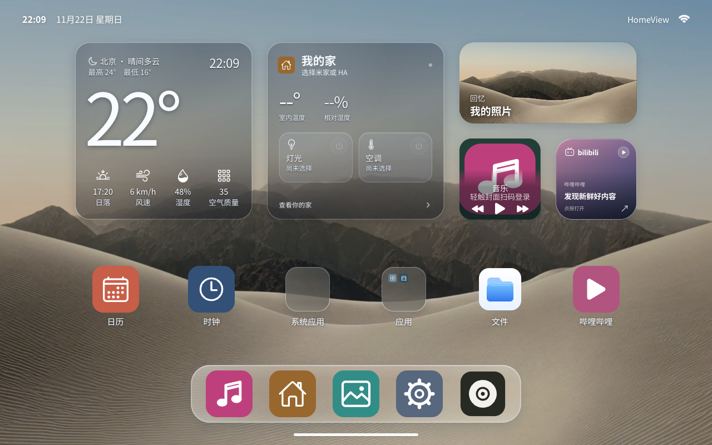
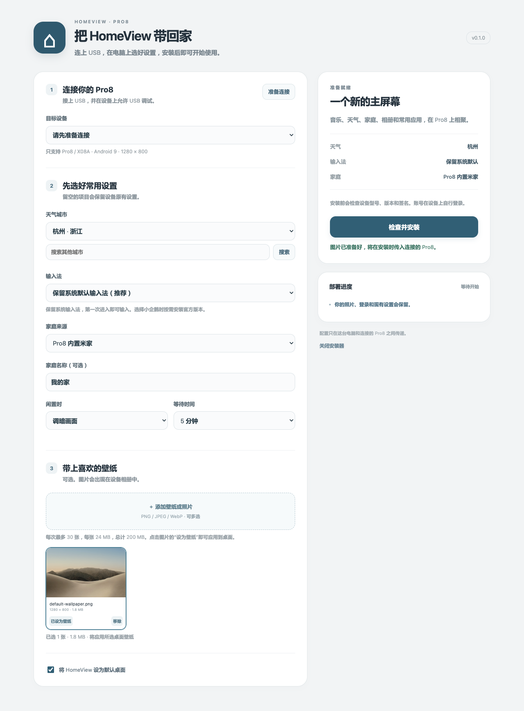
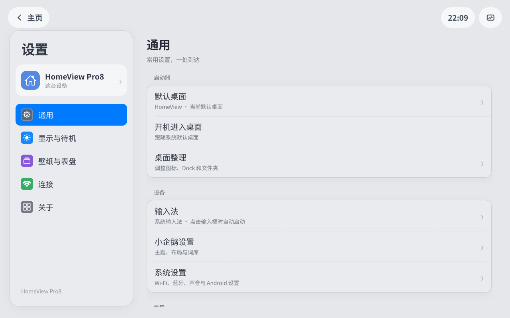
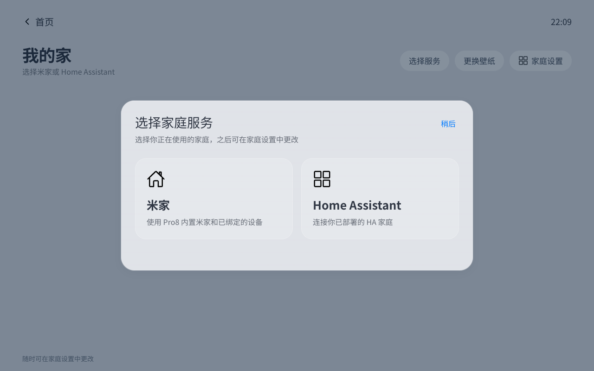
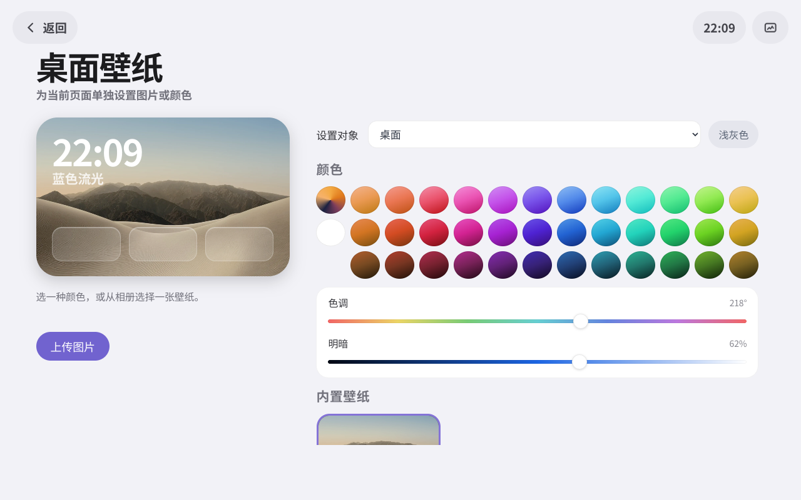

<div align="center">

# x08A HomeView Pro8

</div>

> [!IMPORTANT]
> **安装 HomeView 后，仍保留 Pro8 原生系统和内置米家。**
>
> **单击背部电源键**：在 HomeView 与原生米家桌面之间切换。
>
> **双击背部电源键**：熄屏。
>
> 安装器默认自动检测并配置按键；双击熄屏需要在 Pro8 的系统窗口确认锁屏授权。[查看电源键说明](docs/POWER-KEY.md)

<div align="center">

**让小爱触屏音箱Pro8，成为家里的信息桌面。**

音乐、天气、家庭、相册和常用应用，放到一张熟悉的主屏幕上。

[下载安装器](https://github.com/wegooo-cell/x08A-HomeView-Pro8/releases/latest) · [详细安装步骤](docs/INSTALL.md) · [让 AI 帮你部署](docs/AI-DEPLOY.md) · [常见问题](docs/FAQ.md)

由 **Kiiko厂长** 维护 · 面向 **Pro8 / X08A · Android 9 · ARMv7 · 1280 × 800**



</div>

> 配图来自公开版界面，使用独立示意数据；天气数值不代表实时天气。公开仓库和安装包不包含维护者的账号、家庭设备、登录凭据或个人相册。

## 适用设备与前置准备

**x08A HomeView Pro8** 面向 **小爱触屏音箱Pro8**，在这台带屏智能音箱上提供音乐、天气、家庭控制、相册和应用启动桌面。

| 项目 | 要求 |
| --- | --- |
| 设备 | 小爱触屏音箱Pro8，型号 X08A |
| 已验证环境 | Android 9 · ARMv7 · 1280 × 800 |
| 系统准备 | **提前刷入测试版系统** |
| 连接权限 | **已获取 ADB 权限，并允许电脑的 USB 调试** |

完成以上准备后，再使用 Windows / Mac 部署程序安装 HomeView。刷机与 ADB 权限获取的具体操作参见前置视频教程：

[手把手教你破解小爱音箱丨小米触屏音箱Pro8刷机教程（哔哩哔哩）](https://www.bilibili.com/video/BV1U3C9Y7E61/)

> **电源键切换提醒**：Windows / Mac 安装器默认配置单击切换、双击熄屏；保留原按键配置的恢复记录。双击熄屏需要在 Pro8 上确认系统锁屏授权，拒绝或未完成时会显示待授权。[查看适用条件与恢复方法](docs/POWER-KEY.md)

## 你可以用它做什么

| 页面 | 功能 |
| --- | --- |
| 桌面 | 小组件、点击反馈、图标与文件夹整理、Dock，以及超出一屏后新增页面 |
| 音乐 | 设备端扫码登录、播放、歌词、红心和独立评论窗口；服务可用性取决于第三方接口与账号权限 |
| 家庭 | 首次选择内置米家或已有 Home Assistant；组件可任选两个可开关设备，之后可在家庭设置中更改 |
| 天气 | 只选城市即可使用；UAPI 默认、万象备用，自动切换并缓存上次天气，无需注册或密钥 |
| 相册 | 自动读取 `内置存储/Pictures/HomeView`，查看、设为壁纸、长按或大图中删除 |
| 时钟与待机 | 时钟、计时器、闹钟和可自定义的待机表盘 |
| 系统 | 系统应用文件夹、内置 Android 文件管理器、默认桌面与输入法入口 |

哔哩哔哩入口用于打开设备上已安装的兼容第三方客户端。**本发行版不打包视频客户端，也不携带哔哩哔哩账号**；安装器包含自有兼容入口，用于旧客户端打开 HomeView 相册；本机检测到兼容视频组件时，安装器会安装自有只读兼容桥，用于转发视频标题和封面，保留视频账号。最新视频封面需要兼容客户端提供组件数据，单独安装 HomeView 不会自动获得该能力。其他外部应用入口也需要对应应用已安装。

## 下载：选与你电脑对应的版本

普通用户无需安装 Python 或 Android 开发环境。

| 你的电脑 | 下载文件 |
| --- | --- |
| Windows 10 / 11，64 位 | [HomeView-Windows-x64.zip](https://github.com/wegooo-cell/x08A-HomeView-Pro8/releases/latest/download/HomeView-Windows-x64.zip) |
| Mac，Apple Silicon（M 系列） | [HomeView-macOS-arm64.zip](https://github.com/wegooo-cell/x08A-HomeView-Pro8/releases/latest/download/HomeView-macOS-arm64.zip) |
| Mac，Intel 芯片 | [HomeView-macOS-x64.zip](https://github.com/wegooo-cell/x08A-HomeView-Pro8/releases/latest/download/HomeView-macOS-x64.zip) |
| 已经会使用 ADB | [homeview-pro8.apk](https://github.com/wegooo-cell/x08A-HomeView-Pro8/releases/latest/download/homeview-pro8.apk) |
| 开发与许可证审阅 | [完整对应源码包](https://github.com/wegooo-cell/x08A-HomeView-Pro8/releases/latest/download/HomeView-corresponding-source.zip) |

安装器在你的电脑上运行，会自动准备 Google 官方 ADB，验证应用 SHA256、签名、版本与设备型号。首次使用需要联网下载；连接设备后需在 Pro8 上允许 USB 调试。发行版目前没有商业 Windows 签名或 Apple Developer ID 公证，首次打开方式见[安装说明](docs/INSTALL.md)。

## 三步开始使用

### 1 · USB 连接 Pro8

确认设备已刷入测试版系统、获取 ADB 权限并启用 USB 调试后，使用支持数据传输的 USB 线连接电脑。打开安装器后会自动准备连接工具并持续识别设备。在 Pro8 上允许 USB 调试后，一台在线设备会自动选中；连接多台时手动选择目标。

### 2 · 在电脑上选好设置

- **天气**：选择常用城市，或搜索完整省市名，核对地区后选择。无需注册天气账号或填写密钥；设备自动获取天气，默认源失败时切换备用源，两源均失败时显示带获取时间的缓存。
- **输入法**：默认保留系统输入法；可选官方小企鹅与 [Pro8 浅色定制主题](keyboard/README.md)，不禁用其他键盘。
- **家庭**：选择内置米家，或填写已有 HA 的地址；家庭名称可选。
- **显示**：设置闲置时的待机方式及等待时间。
- **壁纸与照片**：多选导入、预览，并指定其中一张作为桌面壁纸。
- **启动**：默认将 HomeView 设为桌面，并自动配置背部按键：单击切换、双击熄屏；需要时在设备端确认锁屏授权。两项均可取消。
- **系统优化**：默认停用系统应用商店、系统更新组件，并限制这两个组件的后台运行；可取消勾选，[可恢复说明](docs/OPTIMIZATION.md)。

没有填写的可选项目会保留现有设置。默认桌面复选框会按当前选择应用，升级时请根据需要勾选。

<details>
<summary><b>展开查看电脑端配置向导</b></summary>



</details>

### 3 · 点击「检查并安装」

保持 USB 连接，等待显示部署完成。在 Pro8 上登录音乐和家庭服务；已有米家账号沿用设备自身登录。进入相册时按 Android 提示允许照片存储权限。

**HA 需要你已经部署好。**安装器负责连接配置，不会替你部署 HA 服务器；没有 HA 可直接选择 Pro8 内置米家。

[查看完整图文操作、Mac 首次打开、Windows 驱动与排错 →](docs/INSTALL.md)

## 画面预览

### 熟悉的设置页面

分类侧栏把通用、显示与待机、壁纸与表盘、连接和关于集中到一处。



### 家庭服务按需选择

不部署 HA 也可以进入内置米家。米家组件的数据和控制能力取决于设备固件、已有绑定及本机桥接能力；HA 可在设备端授权并选择组件设备。



### 一张默认壁纸，也欢迎你自己的照片

公开包只保留沙丘壁纸。可以从电脑导入其他图片，也可以直接把图片放进设备的 `Pictures/HomeView` 文件夹，HomeView 会自动同步到相册。



## 让 AI 帮你部署

把仓库链接发给支持本地终端的 AI，附上这段话：

```text
请阅读这个仓库的 README.md、AGENTS.md 和 docs/AI-DEPLOY.md，
设备已刷入测试版系统并获取 ADB 权限，
请在已连接并允许 USB 调试的小爱触屏音箱Pro8 上部署 x08A HomeView Pro8。
先列出设备和待应用配置，再安装。
保留系统输入法、设备照片和已有账号，不卸载、不清数据、不降级。
天气城市、家庭来源和壁纸请按我提供的信息设置；不索取账号密码或令牌。
```

也可以使用 Python 3.12 直接打开向导：

```sh
python deploy.py --gui
```

[CLI 配置示例与图片导入 →](docs/AI-DEPLOY.md)

## 数据、升级与返回原桌面

- 公开包不预置任何音乐、哔哩哔哩、米家、HA 或 iCloud 账号。用户自行在设备端授权。
- 图片通过 USB 传入设备，电脑端不向 GitHub 上传图片或配置。临时图片在关闭安装器后清理。
- 覆盖更新保留本包已有登录、桌面和照片。签名冲突或检测到降级时停止，不自动卸载。
- 本公开版使用独立包名，旧个人测试包或朋友分享包不自动迁移；两个版本不要同时运行。[旧版说明](docs/FAQ.md)
- 返回原桌面可在 HomeView 的系统设置入口进入 Android 默认桌面设置，选择系统桌面；电脑端高级操作见安装说明。

[公开版与本地版范围](docs/PUBLIC-SCOPE.md) · [隐私与权限](docs/PRIVACY.md) · [构建说明](docs/BUILDING.md) · [更新记录](CHANGELOG.md) · [报告问题](https://github.com/wegooo-cell/x08A-HomeView-Pro8/issues)

## 开源与致谢

HomeView 公开版整体按 **GPL-3.0** 发布，保留原 HomeView 的 MIT 声明；字体、图标、地图与其他组件沿用各自许可。Release 随二进制提供对应源码和依赖版本记录。

感谢 HomeView 原项目、Android AirPlay Server / UxPlay、OpenSSL、Oboe、FFmpeg、libplist、ZXing、Ionicons、Bootstrap Icons、D3、World Atlas、Source Han Sans，以及小企鹅输入法的开源作者。具体来源见 [THIRD_PARTY.md](THIRD_PARTY.md)。本项目与小米、Apple、网易、哔哩哔哩及 Home Assistant 官方没有隶属关系。
