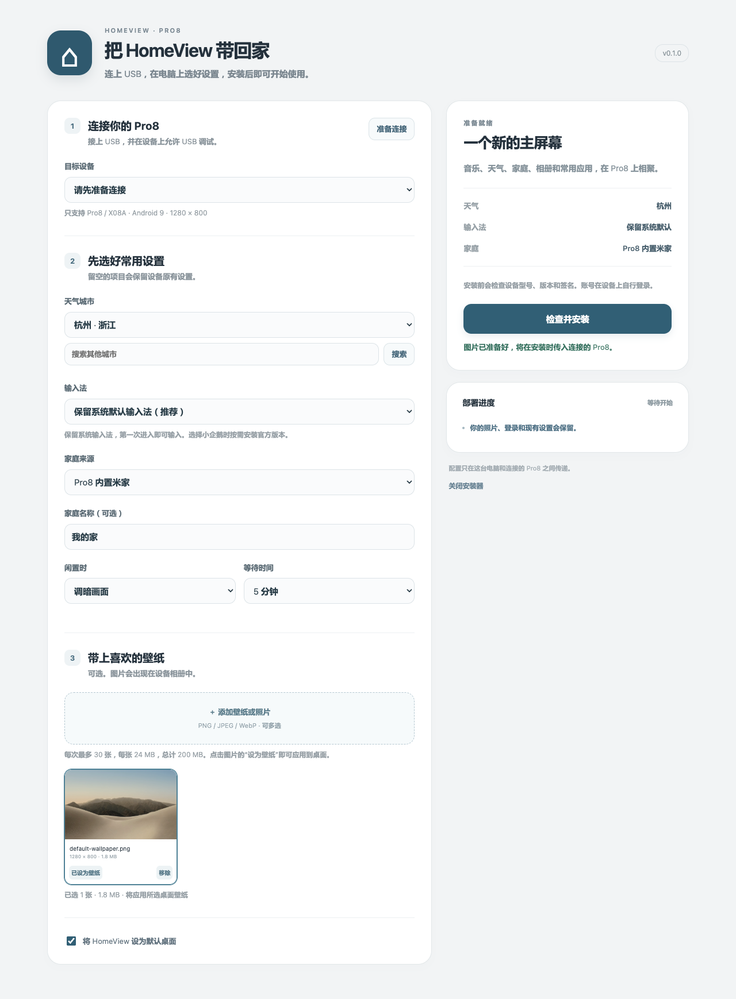
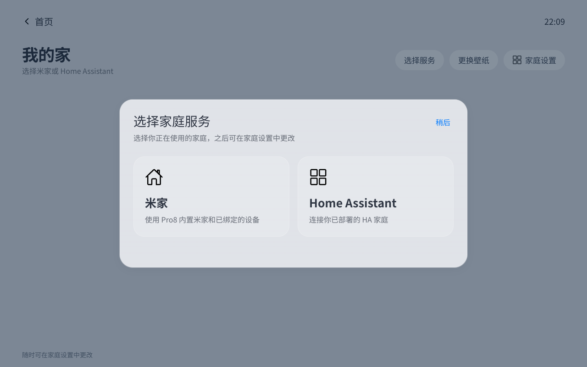

# x08A HomeView Pro8 · 安装与电脑端配置

## 安装前准备

- 设备：小爱触屏音箱Pro8，型号 X08A，Android 9 / ARMv7 / 1280×800。
- 电脑：Windows 10/11 x64，或 Apple Silicon / Intel Mac。macOS 打包最低版本由所带 Python 决定，建议 macOS 13 及以上。
- 一根可传输数据的 USB 线，设备保持供电、亮屏。首次下载 ADB、APK 和可选输入法需要联网。
- **系统前提：提前刷入测试版系统。**
- **权限前提：已获取 ADB 权限，并允许电脑通过 USB 调试连接设备。**

前置准备视频：[手把手教你破解小爱音箱丨小米触屏音箱Pro8刷机教程](https://www.bilibili.com/video/BV1U3C9Y7E61/)。具体刷机与权限获取步骤请参见该视频，完成后再进行下面的 HomeView 部署。

HomeView 部署程序通过已有 ADB 权限安装桌面应用，不负责刷写固件。HomeView 不需要 root。安装器不会设置 Device Owner，不会关闭系统输入法，不会清理账号或相册。

## 1. 下载并打开

进入 [最新 Release](https://github.com/wegooo-cell/x08A-HomeView-Pro8/releases/latest)，选择与你电脑匹配的 ZIP。

| 电脑 | ZIP 中的程序 |
| --- | --- |
| Windows x64 | `HomeView-Installer.exe` |
| M 系列 Mac | arm64 版本的 `HomeView-Installer.app` |
| Intel Mac | x64 版本的 `HomeView-Installer.app` |

先完整解压，再打开程序。安装器会在本机浏览器打开配置窗口，只监听 `127.0.0.1`。

### Mac 首次打开

当前版本没有 Apple Developer ID 公证。确认文件来自本仓库 Release 后，尝试按住 Control 点按应用并选择“打开”；若系统要求，在“系统设置 → 隐私与安全性”中对这个应用选择“仍要打开”。不需要关闭整个系统的安全保护。若显示架构不兼容，检查是否下载了正确的 arm64 / x64 版本。

### Windows 首次打开

当前 exe 没有商业代码签名，系统可能提示未知发布者。只在确认文件来自本仓库且 SHA256 匹配时继续。不要关闭全局安全软件。遇到设备驱动问题见下方排错。

Release 的 `.sha256` 文件用于检查下载完整性；它不替代对下载来源的确认。

## 2. 准备 USB 连接

1. 用数据线连接电脑和 Pro8，打开安装器。
2. 安装器自动准备 Google 官方 Android Platform Tools，并每 3 秒检测设备，无需先点按钮。
3. 在 Pro8 上允许自己的电脑进行 USB 调试；授权后列表会自动更新。
4. 只有一台在线设备时自动选中；多台时选择目标设备。重连后也会自动识别。
5. “重新检测”用于手动刷新，安装期间暂停轮询，避免干扰部署。

未授权、离线或不符合型号的设备不会进入安装步骤。安装过程中不要拔线。

## 3. 在电脑上设置

下图为配置布局示意；新版已改为自动识别设备，并加入默认开启的系统优化选项。



| 项目 | 如何选择 | 留空或保留时 |
| --- | --- | --- |
| 天气城市 | 常用城市下拉，或搜索后核对省市并选择；无需天气账号或密钥，自动切换备用源并缓存上次数据 | 不改当前城市，首次使用可在设备上选 |
| 输入法 | 推荐保留系统默认；也可选择小企鹅 | 不安装或切换键盘 |
| 家庭来源 | 米家 / Home Assistant | 不改已有来源；首次进入家庭时再选 |
| HA 地址 | 完整 HTTP/HTTPS 地址，例如 `http://homeassistant.local:8123` | 不改已有 HA 配置 |
| 家庭名称 | 1–24 个字 | 保留现有名称 |
| 闲置时 | 待机表盘 / 调暗画面 / 保持显示 | 保留现有方式 |
| 等待时间 | 1 / 3 / 5 / 10 分钟 | 保留现有时间 |
| 壁纸与照片 | 添加多张，点击某张的“设为壁纸” | 不导入，不改已有桌面壁纸 |
| 系统组件精简 | 默认开启，仅停用系统应用商店与更新组件 | 取消时不执行此优化 |
| 限制后台 | 默认开启，仅限制上述两个组件 | 取消时不执行此优化 |
| 默认桌面 | 按需要勾选 | 不勾选时不改变系统默认桌面 |

### 图片导入

支持 PNG、JPEG、WebP，每次最多 30 张、每张 24 MB、总计 200 MB。导入时会保留原图，自动生成适合屏幕的预览与桌面裁切。桌面为 16:10，推荐 1280×800 或相同比例。

原图统一放在设备的 `内置存储/Pictures/HomeView`。为避免覆盖已有照片，安装器使用新的唯一文件名。关闭安装器会清理电脑端本次导入的临时副本，不删除电脑原文件。

公开包内只含一张沙丘默认壁纸。首次安装且设备相册目录尚无图片时，安装器会放入这张默认图；更新时不会反复添加，也不会恢复你已经删除的图片。

进入设备相册时允许存储权限，以同步和删除公共文件夹内的照片。删除是真正删除设备原图，请先确认。

### 米家与 HA



- **米家**：沿用 Pro8 内置米家的设备与登录。首次可先点“打开内置米家”检查原应用能否正常使用。本地桥接能显示和控制哪些设备，取决于当前固件、绑定与数据可读情况。
- **HA**：需要已有可访问的 HA 实例。电脑上只填写地址，安装后在 Pro8 上登录授权，再在家庭设置中任选两个支持开关的设备，以及温湿度传感器。两处控制可以都是灯、插座或其他支持的设备，不限定灯和空调各一个。
- 两者都能在家庭设置中再次更改。安装器不部署服务器，不收集账号密码或长期令牌。

## 4. 安装与首次使用

点击 **检查并安装**。安装器先检查设备和现有签名，验证下载文件后覆盖安装，再传入你选定的设置与图片。最后按选择切换默认输入法和默认桌面，再应用勾选的系统优化。优化失败时显示“部分完成”及具体原因，[范围与恢复](OPTIMIZATION.md)。

看到“部署完成”后，在设备上：

1. 点击输入框确认键盘可用；如需更换，在设置 → 通用 → 输入法中选择。
2. 打开天气检查城市与联网情况；服务暂不可用时点击刷新。
3. 在音乐里扫描二维码登录自己的账号。
4. 进入家庭完成米家或 HA 的设备选择。
5. 打开相册允许照片权限。需要悬浮返回等功能时，再按设备提示允许对应权限。

## 5. 更新

从同一公开仓库下载新安装器，再连接设备执行。安装器保留当前账号、照片与配置，只应用你本次选择的项目。升级前检查默认桌面复选框；不希望切换时取消勾选。

如果遇到签名冲突、同版本不同安装包或设备版本更高，安装器会停止。不要为绕过提示而直接卸载；先确认已有包来源及是否需要保留其数据。

旧个人测试版、朋友分享包和这个独立公开版不自动迁移私有账号。切换版本前请关闭旧版；两个版本使用同一本地服务端口，不能同时运行。

## 电源键切换

请先阅读 [电源键适用条件](POWER-KEY.md)。固件已把短按电源键映射成 HOME 时，HomeView 设为默认桌面后，短按可在两个桌面之间切换。安装器不负责写入系统按键映射。

## 返回系统桌面

在 HomeView 设置 → 通用 → 系统设置中打开 Android 设置，找到默认应用/桌面，选择系统桌面。菜单名称随固件不同。

已熟悉 ADB 的用户，也可以先查询系统候选桌面，再指定已确认的组件；不要猜包名：

```sh
adb shell cmd package query-activities --brief -a android.intent.action.MAIN -c android.intent.category.HOME
adb shell cmd package set-home-activity --user 0 已确认的包名/桌面Activity
adb shell input keyevent 3
```

这只切换桌面，不需要卸载 HomeView。

## 排错

| 现象 | 处理 |
| --- | --- |
| 没有设备 | 检查数据线、供电、USB 调试；Windows 在设备管理器查看 Android ADB 驱动是否正常。使用设备厂商适用驱动或 Windows Update |
| unauthorized | 在 Pro8 允许 USB 调试，等待自动识别 |
| offline | 重新插线，保持亮屏，等待后再次扫描 |
| 多台设备 | 只保留要安装的设备，或在列表中明确选择 |
| ADB/APK 下载失败 | 检查电脑能否访问 Google 下载站和 GitHub Release，稍后重新打开安装器 |
| 配置等待超时 | 保持设备亮屏，退出其他 HomeView 版本，再执行一次；应用已安装的情况下会复用相同安装包 |
| HA 连不上 | 检查设备与服务器网络、协议、端口；地址不要包含账号、路径、查询参数或令牌 |
| 天气暂不可用 | 确认城市已设置、设备时间和联网正常，点击刷新；天气服务和网络有时会超时 |
| 相册未同步 | 图片需在 `Pictures/HomeView`，格式需受支持，并允许 HomeView 的存储权限；稍后刷新 |

更多说明见 [常见问题](FAQ.md)。
